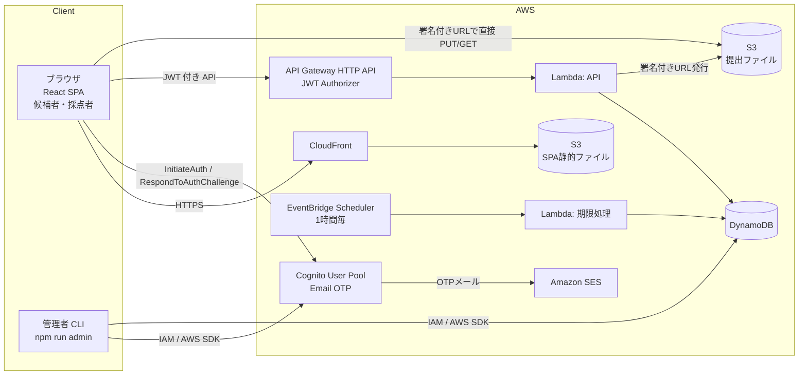
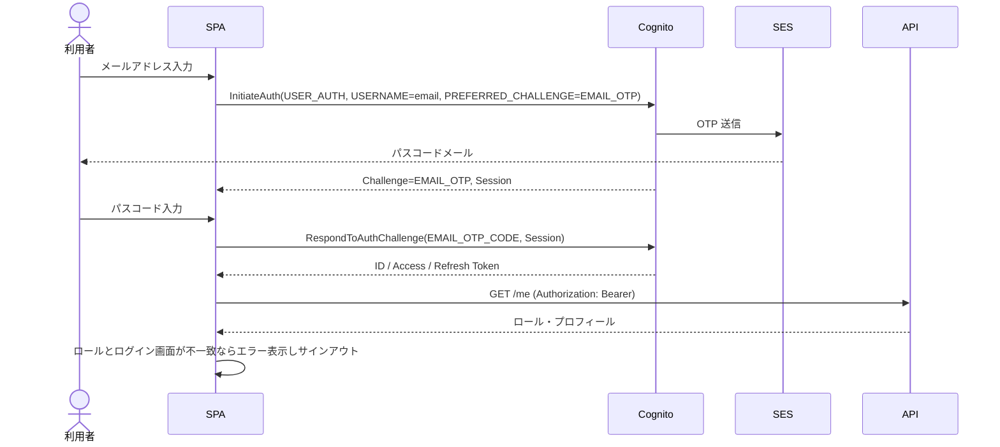
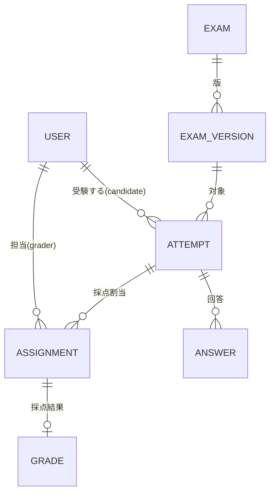
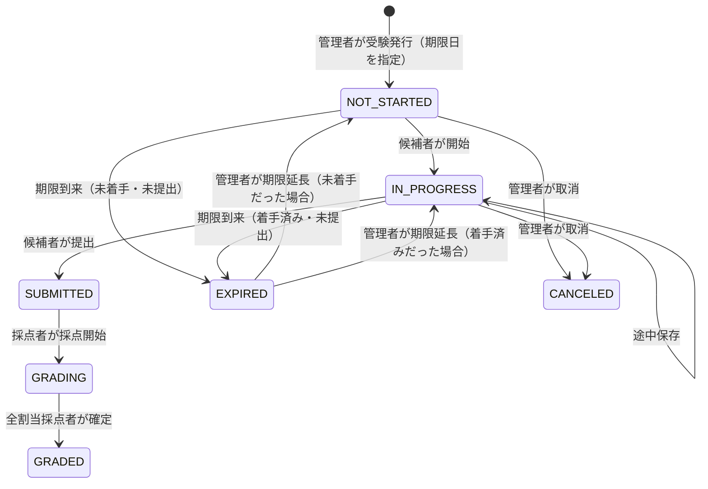

# 採用課題試験管理システム 設計書（MVP）

- ステータス: Draft v0.7
- 対象: MVP（最小構成）
- 前提スタック: TypeScript / Node.js（devcontainer: `typescript-node:24`）、AWS

### 改訂履歴

| 版   | 内容                                                                                                                                                                                     |
| ---- | ---------------------------------------------------------------------------------------------------------------------------------------------------------------------------------------- |
| v0.1 | 初版                                                                                                                                                                                     |
| v0.2 | 未決事項への回答を反映：受験期限（日数指定）、回答形式（記述/選択/コード・ファイル・GitHub URL）、複数採点者、採点者への氏名表示（メール非表示）、管理操作の CLI 化                      |
| v0.3 | 受験期限を **日付指定** に変更、期限切れは **未提出（EXPIRED）** 扱い、コード提出を **zip アップロードのみ** に限定（エディタ入力・GitHub URL は対象外へ）、提出ファイル上限 20MB で確定 |
| v0.4 | 監視を **最小構成**（API エラー、SES バウンス率・苦情率）に絞り、prod のみ設定。概算コストを内訳付きで更新                                                                               |
| v0.5 | `candidate:import` と CLI の監査ログを後続フェーズへ。運用手順書（[runbook.md](runbook.md)）を追加                                                                                       |
| v0.6 | 管理者ロール（Cognito の `admin`）と管理画面を Phase 2 として追加（§14）。IAM で CLI を実行する管理者をスーパー管理者と呼ぶ。監査ログを管理画面と同時に実装する                          |
| v0.7 | 監査ログを業務データと **別のテーブル** に保存する（§14.4、D13）。記録する操作と内容を確定                                                                                               |

---

## 1. 目的とスコープ

採用候補者がオンラインで採用課題に取り組み、採点者がそれを採点するためのシステムを AWS 上に構築する。

### 1.1 MVP に含めるもの

| #   | 機能                                                                             | 利用者           | 提供形態     |
| --- | -------------------------------------------------------------------------------- | ---------------- | ------------ |
| F1  | メールアドレス + ワンタイムパスコード（OTP）によるログイン（毎回 OTP 必須）      | 候補者・採点者   | 画面         |
| F2  | 候補者の事前登録（セルフサインアップ不可）                                       | 管理者           | CLI          |
| F3  | 採点者の事前登録                                                                 | 管理者           | CLI          |
| F4  | 候補者への課題割り当て（＝受験の発行、**受験期限を日付で指定**）                 | 管理者           | CLI          |
| F5  | 課題ページの表示・回答の途中保存・再開（記述／選択／ソースコード zip 提出）      | 候補者           | 画面         |
| F6  | 提出（完了）による課題終了・以降の編集ロック、期限到来時の受付終了（未提出扱い） | 候補者・システム | 画面・バッチ |
| F7  | 受験への採点者割り当て（**複数可**）                                             | 管理者           | CLI          |
| F8  | 割り当てられた回答の閲覧・採点（下書き保存／確定）                               | 採点者           | 画面         |
| F9  | 進捗・採点結果の一覧／CSV 出力                                                   | 管理者           | CLI          |

### 1.2 MVP では対象外（後続フェーズ）

- 管理画面（MVP は CLI スクリプトで運用）→ **Phase 2 で追加**（§14）
- 管理画面からの課題（問題）編集 → MVP では課題定義を **リポジトリ内の JSON/Markdown で管理し、CLI で投入**。**Phase 2 で画面から作成・編集できるようにする**（§14.5）
- 候補者への招待メール自動送信（MVP は管理者が手動でリンクを連絡）
- 採点ルール（複数採点者の集計方法、選択式の自動採点など）→ **別途検討**。MVP では各採点者が問題ごとに点数・コメントを付けるだけの汎用モデルにしておく
- コードのブラウザ内エディタ入力、GitHub URL による提出（MVP のソースコード提出は zip のみ）
- 提出コードの実行・自動テスト、マルウェアスキャン
- 期限処理バッチ失敗のアラーム（期限判定は書き込み時の条件チェックで担保されるため、バッチ失敗は表示上のステータスずれに留まる）
- 管理 CLI の `candidate:import`（CSV 一括登録）。MVP では `candidate:add` を 1 人ずつ実行する。監査ログは Phase 2 で管理画面と同時に実装する（§14.4）

---

## 2. アクター・ロール

| ロール             | 説明                                                                                                               | 利用手段                                                              |
| ------------------ | ------------------------------------------------------------------------------------------------------------------ | --------------------------------------------------------------------- |
| `candidate`        | 候補者。自分に割り当てられた課題のみ閲覧・回答可能                                                                 | 画面 `/login`                                                         |
| `grader`           | 採点者。自分に割り当てられた受験（提出済み）のみ閲覧・採点可能。**候補者の氏名は見えるがメールアドレスは見えない** | 画面 `/grader/login`                                                  |
| スーパー管理者     | すべての管理操作（個人データの削除を含む）                                                                         | **CLI スクリプト**（AWS の IAM 認証で実行。Cognito ユーザーではない） |
| `admin`（Phase 2） | 管理者。日常の運用（登録・課題・受験・割り当て・結果出力）。採点者と兼任できる（§14）                              | 画面 `/admin/login`                                                   |

画面利用者のロールは Cognito User Pool の **グループ**（`candidate` / `grader`、Phase 2 で `admin`）で表現し、トークンの `cognito:groups` クレームで API 側が認可する。Phase 2 では 1 人が `grader` と `admin` を兼ねられる（§14.2）。

---

## 3. アーキテクチャ

### 3.1 方針

- **フルサーバーレス**：常時起動コストを避け、利用頻度が低く波のある採用業務に合わせる
- **認証は自前実装しない**：Cognito のネイティブ「パスワードレス（Email OTP）」を利用
- **管理操作は CLI**：管理者は IAM 権限で AWS SDK を直接呼ぶ。管理用 API・管理画面を作らないことで MVP の攻撃面と実装量を減らす。**Phase 2 で管理者ロールと管理画面を追加し、CLI はスーパー管理者用として残す**（§14）
- **業務ロジックは共通化**：受験発行・状態遷移などのルールは `packages/core` に置き、Lambda と CLI の両方から使う（CLI だけルールが異なる、を防ぐ）
- **IaC は AWS CDK（TypeScript）**

### 3.2 構成図



### 3.3 採用サービスと選定理由

| 領域         | 採用                                                                          | 理由 / 代替案                                                                                                     |
| ------------ | ----------------------------------------------------------------------------- | ----------------------------------------------------------------------------------------------------------------- |
| フロント配信 | S3 + CloudFront                                                               | 低コスト・定番                                                                                                    |
| フロント実装 | React + Vite（SPA）                                                           | 候補者・採点者の画面を 1 SPA にルーティングで収容。Markdown 表示はサニタイズ付きレンダラ                          |
| 認証         | Cognito User Pool（Essentials 機能プラン）の `USER_AUTH` フロー + `EMAIL_OTP` | 要件「メールにパスコード、毎回必須」にそのまま合致。**Email OTP 利用には SES 連携（DEVELOPER 送信）が必須**       |
| メール送信   | Amazon SES                                                                    | 送信元ドメインは別途決定（§9）。決定までは dev 環境で SES サンドボックス＋検証済みアドレスで開発                  |
| API          | API Gateway HTTP API + Lambda（Node.js）                                      | JWT Authorizer が Cognito と直結。Lambda 内は Hono で単一関数にまとめる                                           |
| DB           | DynamoDB（オンデマンド）                                                      | 低トラフィック・スキーマ単純・運用不要                                                                            |
| 提出ファイル | S3（非公開）+ 署名付き URL                                                    | Lambda を経由せずブラウザから直接アップロード／ダウンロード（Lambda のペイロード上限回避）                        |
| 期限処理     | EventBridge Scheduler + Lambda                                                | 期限切れ受験を未提出（EXPIRED）へ遷移。厳密な期限判定は書き込み時の条件チェックで担保し、バッチは状態の後片付け役 |
| 管理操作     | Node.js CLI（`scripts/admin`）                                                | 管理画面不要との方針による（MVP）。Phase 2 で管理画面を追加し、CLI はスーパー管理者用に残す（§14）                |
| IaC          | AWS CDK（TypeScript）                                                         | 言語統一                                                                                                          |

---

## 4. 認証設計

### 4.1 ログインフロー（候補者・採点者共通）



### 4.2 設定方針

| 項目                           | 設定                                                                                                                                                                                                           | 意図                                                                                                             |
| ------------------------------ | -------------------------------------------------------------------------------------------------------------------------------------------------------------------------------------------------------------- | ---------------------------------------------------------------------------------------------------------------- |
| セルフサインアップ             | 無効（`AllowAdminCreateUserOnly`）                                                                                                                                                                             | 事前登録者のみ                                                                                                   |
| ユーザー名                     | email（小文字正規化）                                                                                                                                                                                          |                                                                                                                  |
| 登録時（CLI）                  | `AdminCreateUser` + `email_verified=true` + `MessageAction=SUPPRESS` + グループ付与                                                                                                                            | Cognito の招待メール（仮パスワード）を送らない                                                                   |
| 認証方式                       | ファーストファクターは `EMAIL_OTP`（Cognito の仕様上 `PASSWORD` は無効化できないため、登録時に誰にも開示しないランダムパスワードを設定）。アプリクライアントは `ALLOW_USER_AUTH` のみ許可                      | 利用者がパスワードを知ることはなく、実質 OTP のみでログイン                                                      |
| ユーザー存在エラー防止         | 有効                                                                                                                                                                                                           | 未登録メールの列挙を防ぐ（画面上は「登録済みならメールが届きます」）                                             |
| トークン保存                   | メモリ or sessionStorage（localStorage 不可）                                                                                                                                                                  | ブラウザを閉じたら再ログイン＝OTP 必須                                                                           |
| Refresh Token                  | 最短（60 分）、ログアウト時に `RevokeToken` で失効                                                                                                                                                             | 「再ログイン毎に OTP」を担保                                                                                     |
| Access/ID Token 有効期限       | 60 分                                                                                                                                                                                                          | 受験期間は数日単位のため、候補者は複数回ログインして作業する前提。期限切れ時は未保存入力を退避し再ログインを促す |
| ログアウト後のアクセストークン | API Gateway の JWT オーソライザーは失効を確認しないため、**有効期限（最長 60 分）まで API に通る**。SPA は sessionStorage から破棄する。無効化（`*:disable`）したユーザーは API が DynamoDB を参照して即時拒否 | 許容する。厳密化が必要になれば `jti` の拒否リスト（DynamoDB・TTL）を API で照合                                  |
| 試行制限                       | Cognito 標準のレート制限。API はステージ全体で 200 rps / バースト 400（コスト上限）。送信元 IP 単位の制限は WAF のレートベースルール（prod で検討）                                                            | ブルートフォース・濫用対策。全体上限を低くしすぎると未認証リクエストだけで正規利用者が 429 になる                |

### 4.3 認可

- API Gateway の JWT Authorizer で署名・有効期限・`client_id` を検証
- Lambda ミドルウェアで `cognito:groups` を見てルート単位に認可
- **リソース単位の認可**（候補者は自分の受験のみ、採点者は自分に割り当てのある受験のみ）を必ずサーバー側で実施
- スーパー管理者は Cognito に存在しない。CLI 実行用の IAM ロール（Cognito 管理操作・DynamoDB 読み書き・S3 読み取り）を CDK で作成し、スーパー管理者のみ引き受け可能にする（未実装）
- Phase 2 の管理者（`admin`）の認可は §14.3

---

## 5. 課題定義

課題は `exams/<examId>/` に置き、CLI（`exam:publish`）で DynamoDB に投入する。投入毎に `version` を採番し、受験はどの版で発行されたかを保持する（受験中に課題を直しても既存受験に影響しない）。

```
exams/backend-2026/
├─ exam.json
├─ intro.md
└─ questions/
   ├─ q1.md
   └─ q2.md
```

```jsonc
// exam.json（例）
{
  "examId": "backend-2026",
  "title": "バックエンドエンジニア採用課題",
  "intro": "intro.md",
  "questions": [
    { "qid": "q1", "type": "text", "body": "questions/q1.md", "maxLength": 20000 },
    {
      "qid": "q2",
      "type": "choice",
      "body": "questions/q2.md",
      "multiple": false,
      "options": [{ "id": "a", "label": "..." }, { "id": "b", "label": "..." }]
    },
    {
      "qid": "q3",
      "type": "file",
      "body": "questions/q3.md",
      "file": { "maxSizeMB": 20, "extensions": [".zip"] }
    } // ソースコード提出
  ]
}
```

### 5.1 回答形式

| type     | 入力 UI                                                          | 保存内容                                          |
| -------- | ---------------------------------------------------------------- | ------------------------------------------------- |
| `text`   | Markdown 対応テキストエリア（プレビュー付き）                    | `{ text }`                                        |
| `choice` | ラジオ／チェックボックス                                         | `{ selected: ["a"] }`                             |
| `file`   | zip ファイル選択 → S3 へ直接アップロード（提出前なら差し替え可） | `{ fileKey, fileName, size, sha256, uploadedAt }` |

- 選択肢の正解・配点などの採点情報（rubric）は課題定義に含められるが、**候補者向け API では除外**する

### 5.2 ソースコード（zip）提出の仕様

- 形式は `.zip` のみ、上限 **20MB**（課題定義で問題毎に変更可）
- 拡張子チェックに加え、サーバー側でファイル先頭のマジックナンバー（`PK\x03\x04`）を検証
- サーバーで SHA-256 を記録し、採点画面に表示（提出物の同一性確認用）
- 採点者はダウンロードしてローカルで確認する（MVP ではシステム内での展開・プレビューは行わない）
- 課題文には「`node_modules` / ビルド成果物 / 秘密情報を含めない」旨を記載する運用とする

---

## 6. データモデル（DynamoDB シングルテーブル）

テーブル名: `Haccoli`（PK: `PK`, SK: `SK`）、GSI1（`GSI1PK`, `GSI1SK`）、GSI2（`GSI2PK`, `GSI2SK`）

### 6.1 エンティティ



| エンティティ         | PK                    | SK                   | 主な属性                                                                                                                              | GSI                                                                                 |
| -------------------- | --------------------- | -------------------- | ------------------------------------------------------------------------------------------------------------------------------------- | ----------------------------------------------------------------------------------- |
| User                 | `USER#<sub>`          | `PROFILE`            | email, name, role（Phase 2 で `roles: Role[]`。§14.2）, disabled, createdAt                                                           | GSI1: `EMAIL#<email>` / `USER`                                                      |
| Exam                 | `EXAM#<examId>`       | `META`               | title, latestVersion                                                                                                                  |                                                                                     |
| ExamVersion          | `EXAM#<examId>`       | `V#<version>`        | 課題定義全体（intro, questions[] 本文含む）, publishedAt                                                                              |                                                                                     |
| Attempt（受験）      | `ATTEMPT#<attemptId>` | `META`               | candidateSub, **candidateName**（非正規化）, examId, examVersion, status, issuedAt, **deadlineAt**, startedAt, submittedAt, expiredAt | GSI1: `CAND#<sub>` / `ATTEMPT#<issuedAt>`、GSI2: `STATUS#<status>` / `<deadlineAt>` |
| Answer               | `ATTEMPT#<attemptId>` | `ANS#<qid>`          | type, content（§5.1）, updatedAt, version（楽観ロック）                                                                               |                                                                                     |
| Assignment           | `ATTEMPT#<attemptId>` | `ASSIGN#<graderSub>` | graderName, assignedAt, status(ASSIGNED/DRAFT/DONE)                                                                                   | GSI1: `GRADER#<sub>` / `ASSIGN#<assignedAt>`                                        |
| Grade                | `ATTEMPT#<attemptId>` | `GRADE#<graderSub>`  | items: {qid: {score?, comment?}}, overallComment, finalizedAt                                                                         |                                                                                     |
| ExamDraft（Phase 2） | `EXAM#<examId>`       | `DRAFT`              | 編集中の課題定義, version（楽観ロック）, updatedAt, updatedBy（§14.5）                                                                |                                                                                     |
| AuditLog（Phase 2）  | `AUDIT#<yyyymm>`      | `<timestamp>#<uuid>` | actor, action, target, detail, status（**別テーブル**。§14.4）                                                                        |                                                                                     |

- 受験 1 件に回答・割り当て・採点を同一 PK でぶら下げ、1 クエリで全体を取得
- 監査ログ（AuditLog）だけは別のテーブル（`haccoli-<env>-audit`）に保存する。業務データと一緒に読むことがなく、保持・権限が違うため（§14.4、D13）
- 課題定義は 1 版 1 アイテム（400KB 制約内に収まる想定。超える場合は本文を S3 に逃がす）
- 採点者向けレスポンスは **candidateName のみ**を返し、email は返さない（API のレスポンス型で email を持たない専用 DTO を定義して漏洩を防ぐ）
- Grade は「問題ごとの点数＋コメント」の汎用構造にとどめ、集計ルールは別途検討後に追加

### 6.2 提出ファイル（S3）

- バケット: 非公開、SSE-S3 暗号化、バージョニング有効、パブリックアクセスブロック
- キー: `attempts/<attemptId>/<qid>/<uuid>/<sanitizedFileName>`
- アップロード: API が **署名付き POST**（`content-length-range` 条件でサイズ制限、有効期限 5 分）を発行 → ブラウザから直接送信 → 回答保存 API で `fileKey` を登録（サーバーで `HeadObject` によりプレフィックス・サイズを検証）
- ダウンロード（採点者）: API が割当確認後に署名付き GET URL（有効期限 5 分、`Content-Disposition: attachment`）を発行
- 期限後はアップロード URL を発行しない
- ライフサイクル: 差し替え時に API が旧ファイルを削除し、バージョニングの旧版は 30 日後に削除（それまでは復元可能）
- 既知の制約: アップロードしたが回答として登録しなかったファイル（登録前にタブを閉じた等）は残る。件数・容量が問題になれば、未登録ファイルの棚卸しを CLI に追加する
- バケット CORS は CloudFront のオリジン（dev は `http://localhost:5173` も）からの POST のみ許可。CSP の `connect-src` にバケットのエンドポイントを追加
- 検証（HeadObject の代わりに GetObject で全体を読む）: サイズ・先頭 4 バイト・SHA-256 を 1 回の読み込みで求める。API の Lambda はメモリ 1024MB・タイムアウト 25 秒

### 6.3 受験ステータス遷移



### 6.4 受験期限

- 管理者は受験発行時に **期限日（`YYYY-MM-DD`）** を指定する。`deadlineAt` は **その日の 23:59:59 JST**（内部は UTC の ISO 8601 で保存）
- 過去日・当日以前の指定は CLI でエラー（`--force` で当日指定のみ許可）
- 期限の判定は **サーバー時刻のみ**で行う。開始・回答保存・提出・アップロード URL 発行時に DynamoDB の条件式 `deadlineAt > :now` で拒否（バッチの実行タイミングに依存しない）
- **期限到来時は未提出扱い**：EventBridge Scheduler で 1 時間毎に期限処理 Lambda を起動し、GSI2（`STATUS#NOT_STARTED` / `STATUS#IN_PROGRESS` を `deadlineAt <= now` で検索）から対象を抽出して `EXPIRED` に遷移
- `EXPIRED` の受験は採点対象外（採点者に割り当て不可）。途中保存された回答は削除せず保持し、管理者は CLI で参照可能
- 期限延長は CLI（`attempt:extend --deadline YYYY-MM-DD`）で可能。`EXPIRED` からも延長でき、`startedAt` の有無で `NOT_STARTED` / `IN_PROGRESS` に戻す
- 画面には期限日時と残り日数を常時表示

---

## 7. API 設計

ベースパス `/api`。全エンドポイント JWT 必須（Authorizer）。MVP では管理系 API は持たない（CLI が直接 AWS を操作）。Phase 2 の管理者 API は §14.6。

### 7.1 共通

| Method | Path  | 説明               |
| ------ | ----- | ------------------ |
| GET    | `/me` | 自分のロール・氏名 |

### 7.2 候補者（group: candidate）

| Method | Path                                                       | 説明                                                                                                                    |
| ------ | ---------------------------------------------------------- | ----------------------------------------------------------------------------------------------------------------------- |
| GET    | `/candidate/attempts`                                      | 自分の受験一覧（期限・ステータス）                                                                                      |
| GET    | `/candidate/attempts/{attemptId}`                          | 冒頭説明＋課題本文（rubric 除外）＋保存済み回答＋ステータス。**問題・回答は開始後のみ返す**（未着手の間は冒頭説明のみ） |
| POST   | `/candidate/attempts/{attemptId}/start`                    | 開始                                                                                                                    |
| PUT    | `/candidate/attempts/{attemptId}/answers/{qid}`            | 途中保存（`version` による楽観ロック、型ごとのバリデーション）                                                          |
| POST   | `/candidate/attempts/{attemptId}/answers/{qid}/upload-url` | ファイル提出用の署名付き POST 発行                                                                                      |
| POST   | `/candidate/attempts/{attemptId}/submit`                   | 提出。未回答問題があれば警告（提出は可能）、以降ロック                                                                  |

- エラーは `{ error: { code, message } }`。`404 NOT_FOUND`（他人の受験も同じ）、`400 VALIDATION`、`409 VERSION_CONFLICT`（楽観ロックの競合）、`409 INVALID_STATE`（提出済み・期限切れ・未開始など）
- ステータスは期限処理バッチの実行前でも、期限到来済みで未提出なら `EXPIRED` として返す

途中保存の UX:

- 入力後数秒のデバウンスで自動保存 ＋「保存」ボタン、最終保存時刻を表示
- 別タブ・別端末で同時編集された場合は 409 → 「他の画面で更新されています」通知
- トークン期限切れ時は未保存入力を sessionStorage に退避し、再ログイン後に復元

### 7.3 採点者（group: grader）

| Method | Path                                                      | 説明                                                          |
| ------ | --------------------------------------------------------- | ------------------------------------------------------------- |
| GET    | `/grader/assignments`                                     | 自分の担当一覧（候補者氏名・課題名・提出日時・採点状況）      |
| GET    | `/grader/attempts/{attemptId}`                            | 課題（rubric 含む）＋回答＋自分の採点（**email は含まない**） |
| POST   | `/grader/attempts/{attemptId}/answers/{qid}/download-url` | 提出ファイルの署名付き GET 発行                               |
| PUT    | `/grader/attempts/{attemptId}/grade`                      | 採点の下書き保存                                              |
| POST   | `/grader/attempts/{attemptId}/grade/finalize`             | 採点確定                                                      |

- 他の採点者の採点結果は MVP では見せない（独立採点。扱いは採点ルール検討時に決定）
- 採点の確定後は変更できない（採点者・CLI とも。修正手段は MVP では設けない）
- 初回の下書き保存で受験を `GRADING`、割り当てられた全採点者が確定したら `GRADED` にする。`GRADED` の受験に採点者を追加した場合は `GRADING` に戻す
- 割り当ての解除は MVP では CLI を用意しない（誤って割り当てた場合は DynamoDB を直接操作）
- `result:export` の CSV は UTF-8（BOM 付き）。`= + - @` 等で始まる値は先頭に `'` を付けて無害化（CSV インジェクション対策）。候補者の個人情報を含むため、出力ファイルは所有者のみ読み書き可能にする

---

## 8. 管理 CLI

`npm run admin -- <command>` で実行。AWS プロファイル（管理者用 IAM ロール）と環境（`--env dev|prod`）を指定する。

| コマンド                                              | 内容                                                                                    |
| ----------------------------------------------------- | --------------------------------------------------------------------------------------- |
| `candidate:add --email --name`                        | 候補者登録（Cognito ユーザー作成 + グループ + User 保存）                               |
| `candidate:import --csv`                              | CSV 一括登録（**後続フェーズ**）                                                        |
| `candidate:disable --email`                           | 無効化                                                                                  |
| `grader:add --email --name` / `grader:disable`        | 採点者登録・無効化                                                                      |
| `exam:publish --dir exams/<examId>`                   | 課題定義の検証・投入（新しい版を作成）                                                  |
| `exam:list`                                           | 課題と版の一覧                                                                          |
| `attempt:issue --email --exam --deadline YYYY-MM-DD`  | 受験発行（最新版で発行、期限＝指定日 23:59 JST）                                        |
| `attempt:extend --attempt --deadline YYYY-MM-DD`      | 期限延長（`EXPIRED` からの復帰を含む）                                                  |
| `attempt:cancel --attempt`                            | 取消（未着手・受験中のみ。期限切れ・提出済み以降は不可）                                |
| `attempt:assign --attempt --grader <email>...`        | 採点者割り当て（複数指定可。`EXPIRED` / `CANCELED` は不可）                             |
| `attempt:list [--status]`                             | 受験一覧（進捗・期限・採点状況）                                                        |
| `result:export --exam [--out results.csv]`            | 採点結果の CSV 出力（採点者別の問題ごとの点数・コメント）                               |
| `user:purge --email`                                  | 個人データ削除（Cognito・DynamoDB・S3）。候補者のみ・採点済みか取消・期限切れの受験のみ |
| `admin:add --email [--name]` / `admin:remove --email` | 管理者の権限の付与・削除（Phase 2。採点者への付与、または新規登録）                     |

- （**Phase 2**）CLI の変更操作はすべて実行者（IAM プリンシパル）・内容を DynamoDB の監査ログ（別テーブル `haccoli-<env>-audit`）に残す（§14.4。Step 7 で実装）。確認には `audit:list` を使う（[runbook.md](runbook.md) 2.9）
- 本番操作時は確認プロンプトを出す

---

## 9. 画面設計（概要）

```
/login                     候補者ログイン（メール → パスコード）
/exam                      自分の課題一覧（1件なら自動遷移）
/exam/:attemptId           課題回答画面（問題ナビ / 本文 / 回答欄 / 保存状態 / 期限表示 / 提出）
/exam/:attemptId/done      提出完了

/grader/login              採点者ログイン
/grader                    担当一覧（未採点/下書き/確定）
/grader/:attemptId         採点画面（左: 問題+回答（記述・選択結果・zip ダウンロードと SHA-256） / 右: 採点基準・点数・コメント）
```

- ログイン画面は 2 つに分けるが、内部実装は共通コンポーネント
- ログイン後、`/me` のロールと画面種別が一致しなければ拒否
- Phase 2 の管理画面（`/admin/*`）は §14.7

---

## 10. 非機能・セキュリティ

| 観点           | 方針                                                                                                                                                                                                                                                                                                                                                                                                                                                                                   |
| -------------- | -------------------------------------------------------------------------------------------------------------------------------------------------------------------------------------------------------------------------------------------------------------------------------------------------------------------------------------------------------------------------------------------------------------------------------------------------------------------------------------- |
| 通信           | HTTPS のみ。CloudFront で HSTS・CSP 等のセキュリティヘッダ付与                                                                                                                                                                                                                                                                                                                                                                                                                         |
| API の公開経路 | SPA からは CloudFront の `/api/*` 経由（同一オリジン）。**既知の制約**：API Gateway の既定エンドポイント（execute-api）にも直接到達できる。JWT 必須のため認証の迂回にはならないが、CloudFront 側の WAF・セキュリティヘッダーは効かない。WAF 導入時に、CloudFront が付与する秘密ヘッダーの検証かリージョナル WAF で塞ぐ                                                                                                                                                                 |     |
| 認可           | ロール認可 + リソース所有者チェックをサーバー側で必須化（IDOR 対策）                                                                                                                                                                                                                                                                                                                                                                                                                   |
| 情報分離       | 候補者向けから rubric・他者情報を除外。採点者向けから候補者 email を除外（専用 DTO）                                                                                                                                                                                                                                                                                                                                                                                                   |
| 入力           | 型ごとのサイズ上限、Markdown 表示時の XSS 対策（サニタイズ、`innerHTML` 不使用）                                                                                                                                                                                                                                                                                                                                                                                                       |
| 提出ファイル   | zip のみ・20MB 上限・マジックナンバー検証、ダウンロードは attachment 指定。採点者には「信頼できないファイルとして扱う」運用を周知。将来 GuardDuty Malware Protection for S3 を検討                                                                                                                                                                                                                                                                                                     |
| データ保護     | DynamoDB 暗号化（既定）・PITR 有効、S3 暗号化・パブリックブロック・OAC                                                                                                                                                                                                                                                                                                                                                                                                                 |
| ログ           | 構造化ログ（操作者 sub・操作・対象 ID）。個人情報・回答本文はログに出さない                                                                                                                                                                                                                                                                                                                                                                                                            |
| 監視           | **最小構成・prod のみ**：① API 5xx / Lambda エラー（候補者が受験・提出できない障害の検知）② SES バウンス率・苦情率（送信停止による全員ログイン不可の予防）。CloudWatch アラーム → SNS → メール通知（発生時と復旧時）。① は API 5xx と Lambda Errors のそれぞれ 5 分間に 1 件以上、② はバウンス率 4%・苦情率 0.08% 以上（AWS の審査の目安 5%・0.1% の手前）。通知先はデプロイ時に `-c alarmEmail` または `HACCOLI_ALARM_EMAIL` で指定する。dev はアラームなし（CloudWatch Logs で確認） |
| 環境           | `dev` / `prod` の 2 環境（AWS アカウント分離を推奨）                                                                                                                                                                                                                                                                                                                                                                                                                                   |
| デプロイ       | GitHub Actions（OIDC で AWS ロールを引き受け、アクセスキーは保持しない）。`develop` → dev、`main` → prod。当面は CloudFront 既定ドメインで公開                                                                                                                                                                                                                                                                                                                                         |     |
| 個人情報       | 不採用者データの保持期間を決め、`user:purge` で削除                                                                                                                                                                                                                                                                                                                                                                                                                                    |

### 10.1 概算コスト（月間候補者数十〜数百名想定）

前提：候補者 100 名・採点者 10 名／月、OTP メール 700 通／月、提出 zip 20MB／人。東京リージョン、1 環境あたり。

| サービス                                    | 月額（USD）                     |
| ------------------------------------------- | ------------------------------- |
| Cognito（Essentials、10,000 MAU まで無料）  | 0                               |
| SES（1,000 通あたり 0.10）                  | 約 0.07                         |
| DynamoDB（オンデマンド・PITR）              | 約 0.06                         |
| S3（提出ファイル）                          | 約 0.05（保持期間に応じて累積） |
| CloudFront / Lambda / EventBridge Scheduler | 0（無料枠内）                   |
| API Gateway HTTP API                        | 約 0.07                         |
| CloudWatch（アラーム 2 種 4 個・Logs）      | 約 0.5                          |
| **合計**                                    | **約 1 USD 未満**               |

- 別途：WAF を付ける場合は月 8〜10 USD、カスタムドメインは Route 53 ホストゾーン月 0.5 USD ＋ドメイン代
- 無料枠はアカウント（または Organization）単位で共有。他システムと同居する場合は Cognito が超過する可能性があるが、110 MAU でも月 1.65 USD 程度
- 候補者が 10 倍（1,000 名／月）でも月 3〜5 USD 程度

---

## 11. 未決事項

### 11.1 確定済み

| #   | 論点                 | 決定                                                                                                  |
| --- | -------------------- | ----------------------------------------------------------------------------------------------------- |
| D1  | 受験期限             | 管理者が受験毎に **期限日（日付）** を指定。当日 23:59 JST まで                                       |
| D2  | 回答形式             | 記述・選択・ソースコード提出（**zip のみ**、20MB 上限）                                               |
| D3  | 採点者数             | 複数。採点の集計ルールは別途検討                                                                      |
| D4  | 採点者への候補者情報 | 氏名は表示、メールは非表示                                                                            |
| D5  | 管理操作             | MVP は CLI スクリプト（管理画面なし）。Phase 2 で管理画面を追加（D8）                                 |
| D6  | メール送信元ドメイン | 別途決定（決定までは dev の SES サンドボックスで開発）                                                |
| D7  | 期限到来時の扱い     | **未提出（EXPIRED）**。自動提出はしない。保存済み回答は保持                                           |
| D8  | 管理者ロール         | Cognito の `admin` と管理画面を追加（Phase 2）。IAM で CLI を実行する管理者はスーパー管理者として残す |
| D9  | 管理者の操作範囲     | 日常の運用すべて。個人データの削除はスーパー管理者のみ                                                |
| D10 | ロールの兼任         | `grader` と `admin` は兼任できる。`candidate` は兼ねない                                              |
| D11 | 管理者の権限の付与   | 管理者同士で付与・削除できる（自分自身は外せない）                                                    |
| D12 | 課題の登録           | 画面で作成・編集（下書き → 公開で新しい版）                                                           |
| D13 | 監査ログの保存先     | 業務データと別の DynamoDB テーブル（操作と同じトランザクションで書ける。API から削除させない）        |

### 11.2 要確認（実装は仮置きで進行可能）

| #   | 論点                                    | 仮置き                                        |
| --- | --------------------------------------- | --------------------------------------------- |
| Q5  | 候補者 1 人に複数課題を出すことはあるか | モデルは対応済み、UI は一覧から選択           |
| Q6  | 画面のカスタムドメイン                  | ACM で発行（送信元ドメインと合わせて決定）    |
| Q7  | 候補者データの保持期間                  | 選考終了後 N か月で `user:purge`（運用）      |
| Q8  | 管理者の多要素認証                      | メール OTP のみ。必要なら管理者に TOTP を追加 |

---

## 12. リポジトリ構成案

npm workspaces によるモノレポ。

```
haccoli/
├─ packages/
│  ├─ infra/        # AWS CDK（1 環境 1 スタック。Construct: Auth / Data / Storage / Api / Web / Jobs）
│  ├─ core/         # ドメインロジック（状態遷移・期限計算・課題定義スキーマ）、DynamoDB リポジトリ
│  ├─ api/          # Lambda ハンドラ（Hono）、期限処理 Lambda
│  ├─ web/          # React + Vite SPA
│  ├─ admin-cli/    # 管理 CLI（core を利用）
│  └─ shared/       # API の型・zod スキーマ（api / web で共有）
├─ exams/           # 課題定義（JSON + Markdown）
└─ docs/
   └─ design.md
```

- Lint/Format: Biome（devcontainer に導入済み）
- テスト: Vitest（core はユニットテスト中心、DynamoDB はローカル実行環境でテスト）

---

## 13. 実装ステップ案

| Step | 内容                                                                                                                               | 完了条件                                      |
| ---- | ---------------------------------------------------------------------------------------------------------------------------------- | --------------------------------------------- |
| 0    | AWS アカウント準備、SES（dev はサンドボックス）                                                                                    | 開発開始可能                                  |
| 1    | モノレポ雛形、CDK で Cognito（Email OTP）+ SES + SPA 配信、CLI `candidate:add` / `grader:add`                                      | dev で OTP ログインできる                     |
| 2    | DynamoDB・API 基盤（JWT 認可・ロール/所有者チェック）、`/me`                                                                       | ロール別にログイン画面が振り分く              |
| 3    | 課題定義スキーマ・`exam:publish`・`attempt:issue`、候補者の回答（記述/選択）・途中保存・提出                                       | 候補者が受験〜提出まで完了                    |
| 4    | zip 提出（S3 署名付き URL）、期限処理バッチ（EXPIRED 遷移）・`attempt:extend`                                                      | 期限・全回答形式が動く                        |
| 5    | `attempt:assign`、採点画面（下書き・確定）、`attempt:list` / `result:export`                                                       | 一連の業務フローが通る                        |
| 6    | 監視（最小構成のアラーム 2 種、§10）、送信元ドメイン確定後に prod 構築、運用手順書                                                 | 本番リリース                                  |
| 7    | 管理者ロールの土台：`roles` への移行、`admin` グループ、`admin:add` / `admin:remove`、管理者 API の Lambda と認可、監査ログ（§14） | 管理者が API を呼べ、変更操作が監査ログに残る |
| 8    | 管理画面：利用者・受験・割り当て・採点結果・監査ログ（§14.7）                                                                      | 課題の登録以外を画面で運用できる              |
| 9    | 管理画面：課題の作成・編集（下書き・プレビュー・公開。§14.5）                                                                      | 課題を画面で作成・公開できる                  |

---

## 14. 管理者ロールと管理画面（Phase 2）

MVP は管理操作を CLI に限定していた（§3.1）。本番運用で、AWS の権限を持たない担当者も日常の運用を行えるよう、Cognito の **管理者（`admin`）** と管理画面を追加する。AWS の IAM で CLI を実行する従来の管理者は **スーパー管理者** と呼ぶ。

### 14.1 ロールと操作の範囲

| 操作                                  | スーパー管理者（CLI） | 管理者（画面） | 採点者 | 候補者 |
| ------------------------------------- | :-------------------: | :------------: | :----: | :----: |
| 候補者・採点者の登録・無効化          |           ○           |       ○        |        |        |
| 管理者の権限の付与・削除              |           ○           |    ○（※1）     |        |        |
| 課題の作成・編集・公開                |  ○（`exam:publish`）  |       ○        |        |        |
| 受験の発行・期限延長・取消            |           ○           |       ○        |        |        |
| 採点者の割り当て                      |           ○           |       ○        |        |        |
| 進み具合・回答・採点結果の閲覧        |           ○           |       ○        |        |        |
| 採点結果の CSV 出力（個人情報を含む） |           ○           |       ○        |        |        |
| 監査ログの閲覧                        |           ○           |       ○        |        |        |
| 個人データの削除（`user:purge`）      |           ○           |                |        |        |
| 採点                                  |                       |                |   ○    |        |
| 受験                                  |                       |                |        |   ○    |

- ※1 管理者は、採点者・管理者のアカウントに管理者の権限を付与・削除できる。管理者がいなくなるのを防ぐため、画面からは次の操作をできなくする
  - 自分自身の `admin` を外す・自分自身を無効化する
  - **有効な管理者が最後の 1 人のとき**、その人の `admin` を外す・無効化する（管理者同士で互いに外し合っても 0 人にならない）
  - 管理者がいなくなっても、スーパー管理者が CLI で付与できる
- 個人データの削除は元に戻せないため、スーパー管理者のみとする
- 管理者は候補者のメールアドレスを閲覧できる（受験の発行・連絡に必要）。採点者には引き続き見せない

### 14.2 複数ロール

- 1 人が複数のロールを持てる。認めるのは **`grader` と `admin` の組み合わせのみ**。`candidate` は他のロールと兼ねない（社外の候補者に社内の権限を付けない）
- User の `role` を **`roles: Role[]`** に変える（§6.1）。既存データは Step 7 のデプロイ時に **一括で移行** する（スーパー管理者が CLI で実行。`role` → `roles: [role]`）。読み込み側は、移行漏れに備えて `role` しかないアイテムも `[role]` として扱う
- **最後のロールは外せない**。どのロールも持たない有効なユーザー（どの画面にも入れない）を作らないため。利用を止めるときは無効化する。`admin:add` で新規登録した人は `roles: [admin]` になる
- Cognito のグループも複数付与する（`grader` と `admin`）
- `role` から `roles` への変更に合わせて直す箇所
  - core：ロールの判定（`assignGraders` の採点者チェック、`issueAttempt` の候補者チェック、`planPurge` の候補者チェック）、`registerUser`、`listUsers` の絞り込み（`contains(roles, :r)`）
  - API：`AuthUser.role` → `roles`、`requireRole`（含むかで判定）、`/me`
  - web：ロールと画面の対応（`ROLE_ROUTES`）、ログイン後のロールの判定
  - CLI：`candidate:list`・`grader:list` の表示
- `/me` は `roles` を返す。ログイン画面は今と同じく画面ごとに分け（`/login`・`/grader/login`・`/admin/login`）、その画面のロールを持たなければ拒否する。両方を持つ人は、それぞれのログイン画面から入る

### 14.3 認可

- API は **トークンの `cognito:groups` と DynamoDB の `roles` の両方** に、そのルートのロールがあるときだけ通す（今の `role` の照合を `roles` に拡張する）
  - 付与：グループはトークンの発行時に入るため、**次にトークンが発行されたとき（ログイン、またはリフレッシュ）から有効**
  - 削除・無効化：DynamoDB を毎回照合するため、**即時に無効**（発行済みのトークンが有効期限内でも通さない）
- 両方がそろわないと通さないため、途中で片方だけ成功しても権限は残らない。そのうえで順序を次のように決める
  - 付与：Cognito（グループ）→ DynamoDB（`roles`）。DynamoDB で失敗したら Cognito を戻す（登録の `registerUser` と同じく、Cognito を先に作り、失敗したら Cognito を戻す）
  - 削除：DynamoDB → Cognito。DynamoDB を先に変えるので、その時点で即時に無効になる。Cognito で失敗しても権限は残らず、再実行でそろえる
- **管理者 API は別の Lambda に分ける**。次の権限は管理者 API の Lambda だけに与え、候補者・採点者の API の Lambda の権限は今のまま（Scan なし）にする
  - Cognito のユーザー管理（`AdminCreateUser`・`AdminAddUserToGroup`・`AdminRemoveUserFromGroup`・`AdminDisableUser` など）
  - DynamoDB の `Scan`（利用者・課題・受験の一覧）と GSI2 の `Query`（状態ごとの受験）。一覧の API は、Scan とフィルタで空のページを返さないよう、指定件数に達するか最後まで読み進めてから返す
- 候補者・採点者の API から管理者の操作に到達できないことを、ルート単位の認可テストで固定する

### 14.4 監査ログ

管理画面と同時に実装する（§8 で後続フェーズとしていたもの）。管理者（画面）とスーパー管理者（CLI）の **すべての変更操作** を記録する。

| 項目     | 内容                                                                                                                                                                                                                 |
| -------- | -------------------------------------------------------------------------------------------------------------------------------------------------------------------------------------------------------------------- |
| テーブル | 業務データと別のテーブル `haccoli-<env>-audit`（PITR を有効、prod は削除保護・RETAIN）                                                                                                                               |
| キー     | PK `AUDIT#<yyyymm>`（JST の年月）、SK `<timestamp>#<uuid>`                                                                                                                                                           |
| 実行者   | 管理者は `sub`・氏名、スーパー管理者は IAM のプリンシパル（`sts:GetCallerIdentity` の ARN）                                                                                                                          |
| 操作     | `user.add`・`user.roles`・`user.disable`・`user.purge`・`user.migrate-roles`・`exam.publish`・`attempt.issue`・`attempt.extend`・`attempt.cancel`・`attempt.assign`・`result.export`（Step 9 で `exam.save` を追加） |
| 対象     | 利用者の `sub`・受験 ID・課題 ID など                                                                                                                                                                                |
| 内容     | 変更の要点（例: 付与したロール、新しい期限）。**回答・採点の本文や、対象者のメールアドレス・氏名は含めない**（対象者は `sub` で記録する。失敗の理由に含まれるメールアドレスは伏せる）                                |

- 記録は `packages/core` の各操作で行い、API と CLI で漏れがないようにする。書き込むタイミングは操作の種類で分ける
  - **DynamoDB だけの操作**（受験の発行・延長・取消・割り当て、課題の保存・公開など）：操作と同じトランザクションで書く。記録できなければ操作も行われない
  - **Cognito・S3 にまたがる操作**（登録・ロールの変更・無効化・個人データの削除）：実行前に `status: STARTED` で書き、終わったら `SUCCEEDED` / `FAILED` に更新する。実行前の書き込みに失敗したら操作しない。最後の更新に失敗した場合は `STARTED` のまま残るので、一覧で「結果不明」と表示し、対象の状態を確かめる
- 登録（`user.add`）は Cognito で作るまで `sub` が決まらないため、対象は成功時に記録する（失敗した登録は対象なし）
- 採点結果の CSV 出力（`result.export`）は読み取りだが、個人情報を含むため、データを渡す前に記録する（記録できなければ出力しない）
- 個人データの削除（`user:purge`）でも、監査ログには削除した事実（対象の `sub`・受験 ID・実行者・日時）が残る。メールアドレス・氏名は残さない
- **業務データと別のテーブルにする**（D13）。シングルテーブル（§6.1）は「一緒に読むデータを同じキーに置く」ための設計で、監査ログは業務データと一緒に読まない。分けることで次の利点がある。DynamoDB のトランザクションは同じアカウント・リージョンのテーブルをまたげるため、操作と同じトランザクションで書く方針は変わらない
  - 利用者・受験の一覧（Scan）が監査ログを読まない
  - 管理者 API の Lambda（Step 7-3）に、監査ログのテーブルへの書き込み（`PutItem`・`UpdateItem`）と読み取りだけを与え、削除させない。スーパー管理者（IAM）は削除できるため、CLI からの改ざんは CloudTrail と IAM の運用で防ぐ
  - 保持期間・削除保護を業務データと別に決められる
- 保持期間は当面無期限。件数は年に数千件・数 MB の見込み（管理者の変更操作 1 回につき 1 件）で、保存料金はほぼかからない。必要になれば TTL（例: 5 年）を設定する
- 管理画面に一覧（月ごと・操作の種類で絞り込み）を設ける

### 14.5 課題の作成・編集

- 課題は画面で作成・編集する。編集中の内容は **下書き**（`EXAM#<examId>` / `DRAFT`、楽観ロック用の `version` を持つ）に保存し、「公開」で新しい版（`V#<version>`）を作る。版の考え方は今と同じで、発行済みの受験には影響しない（§5）
- 新しい課題は、下書きを最初に保存したときに `META` も作る（`latestVersion` なし）。課題の一覧（`listExams` は `META` を読む）に、未公開の課題も出すため。未公開の課題には受験を発行できない（`issueAttempt` は公開済みの版がなければ拒否する）
- 公開時の検証は `exam:publish` と同じ（`parseExamDefinition`）。問題の追加・削除・並べ替え、回答形式（記述・選択・ファイル）、選択肢、配点・採点基準を編集できる。本文は Markdown で、候補者・採点者の画面と同じ表示でプレビューする
- `examId` は作成時に決め、変更できない
- 画面で編集するようになった後は、**DynamoDB の最新版を正** とする。リポジトリの `exams/` はサンプルと初期投入用に残す。CLI の `exam:publish` で投入すると、画面で編集した内容を上書きした新しい版になるため、手順書で注意する

### 14.6 API（`/api/admin/*`、group: admin）

| Method | Path                                                     | 説明                                                        |
| ------ | -------------------------------------------------------- | ----------------------------------------------------------- |
| GET    | `/admin/users?role=`                                     | 利用者の一覧                                                |
| POST   | `/admin/users`                                           | 登録（候補者、または採点者・管理者）                        |
| PUT    | `/admin/users/{sub}/roles`                               | 採点者・管理者のロールの付与・削除（自分の `admin` は不可） |
| POST   | `/admin/users/{sub}/disable`                             | 無効化（自分自身は不可）                                    |
| GET    | `/admin/exams`                                           | 課題の一覧（最新版・下書きの有無）                          |
| GET    | `/admin/exams/{examId}`                                  | 最新版と下書き                                              |
| PUT    | `/admin/exams/{examId}/draft`                            | 下書きの保存（作成を含む。楽観ロック）                      |
| POST   | `/admin/exams/{examId}/publish`                          | 下書きを検証して新しい版として公開                          |
| GET    | `/admin/attempts?status=&examId=`                        | 受験の一覧（進み具合）                                      |
| POST   | `/admin/attempts`                                        | 受験の発行                                                  |
| GET    | `/admin/attempts/{attemptId}`                            | 受験の詳細（回答・割り当て・各採点者の採点）                |
| POST   | `/admin/attempts/{attemptId}/extend`                     | 期限の変更                                                  |
| POST   | `/admin/attempts/{attemptId}/cancel`                     | 取消                                                        |
| POST   | `/admin/attempts/{attemptId}/assign`                     | 採点者の割り当て                                            |
| POST   | `/admin/attempts/{attemptId}/answers/{qid}/download-url` | 提出ファイルの署名付き GET 発行                             |
| GET    | `/admin/exams/{examId}/results.csv`                      | 採点結果の CSV（`result:export` と同じ形式）                |
| GET    | `/admin/audit?month=&action=`                            | 監査ログ                                                    |

- 業務ルールは CLI と同じ `packages/core` の関数を使う（例: 期限切れ・取消の受験には割り当てられない）
- 一覧はページングする（`attempt:list` は全件取得のため、件数が増えたら API 側で区切る）

### 14.7 画面

```
/admin/login               管理者ログイン（メール → パスコード）
/admin                     ダッシュボード（状態ごとの受験数、採点待ち・期限が近い受験）
/admin/users               利用者の一覧・登録・ロールの付与と削除・無効化
/admin/exams               課題の一覧・新規作成
/admin/exams/:examId       課題の編集（下書き保存・プレビュー・公開・版の履歴）
/admin/attempts            受験の一覧（絞り込み）・発行
/admin/attempts/:attemptId 受験の詳細（回答・採点の閲覧、期限変更・取消・採点者の割り当て）
/admin/results             採点結果の CSV 出力
/admin/audit               監査ログ
```

- 取消・無効化・権限の削除など元に戻せない操作は、確認ダイアログを出す
- CSV の出力は個人情報を含むため、出力時に注意を表示し、監査ログに残す

### 14.8 実装の段階

1. **Step 7（管理者ロールの土台）**：`roles` への移行、Cognito の `admin` グループ、CLI の `admin:add` / `admin:remove`、管理者 API の Lambda と認可、監査ログ（CLI の変更操作を含む）
2. **Step 8（管理画面：日常の運用）**：利用者・受験・割り当て・採点結果・監査ログの画面
3. **Step 9（管理画面：課題の作成・編集）**：下書き・プレビュー・公開

Step 7 だけでも、CLI の操作に監査ログが付く。Step 8 までで、課題の登録以外は画面で運用できる（課題は Step 9 まで CLI の `exam:publish`）。
