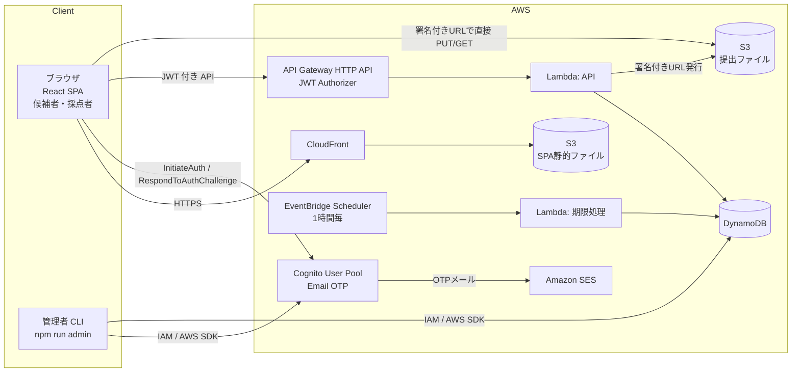
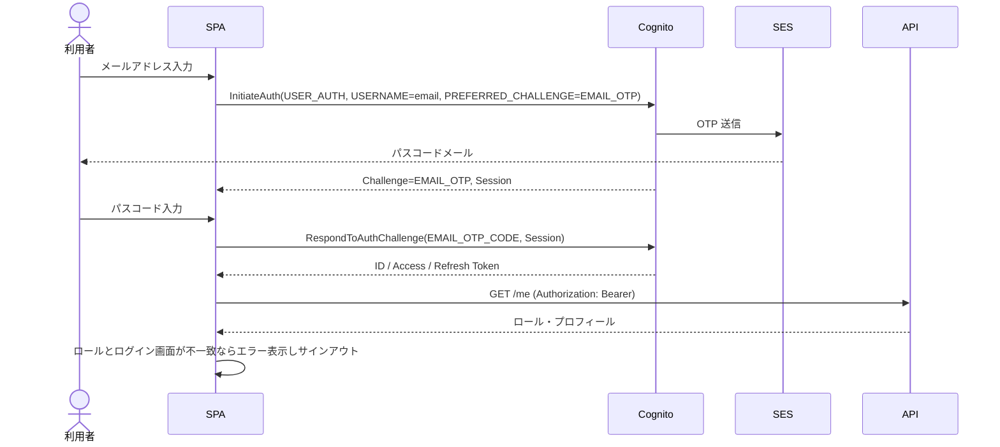
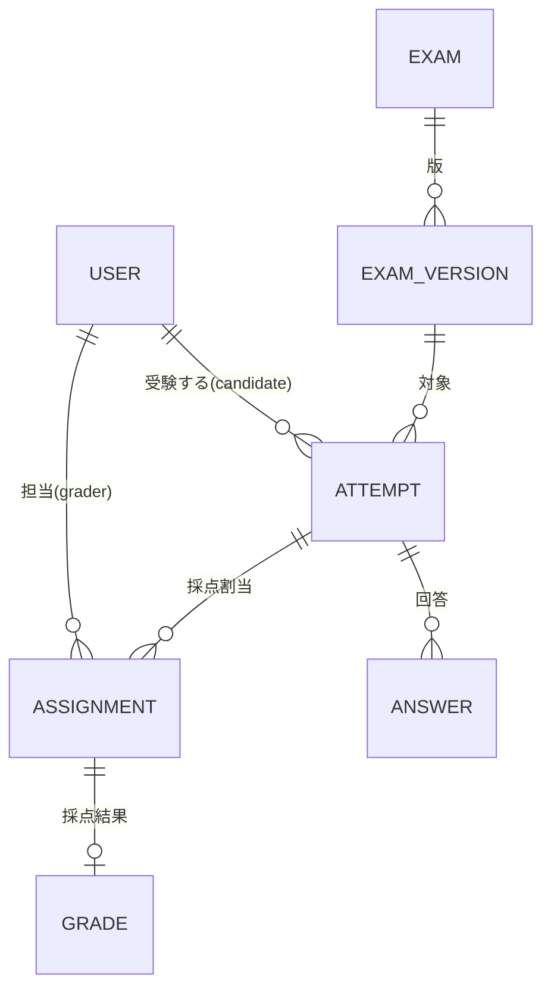
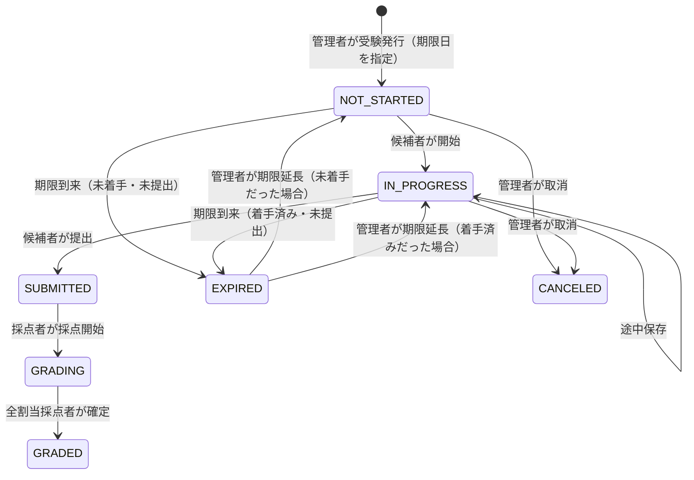

# 採用課題試験管理システム 設計書（MVP）

- ステータス: Draft v0.4
- 対象: MVP（最小構成）
- 前提スタック: TypeScript / Node.js（devcontainer: `typescript-node:24`）、AWS

### 改訂履歴

| 版   | 内容                                                                                                                                                                                     |
| ---- | ---------------------------------------------------------------------------------------------------------------------------------------------------------------------------------------- |
| v0.1 | 初版                                                                                                                                                                                     |
| v0.2 | 未決事項への回答を反映：受験期限（日数指定）、回答形式（記述/選択/コード・ファイル・GitHub URL）、複数採点者、採点者への氏名表示（メール非表示）、管理操作の CLI 化                      |
| v0.3 | 受験期限を **日付指定** に変更、期限切れは **未提出（EXPIRED）** 扱い、コード提出を **zip アップロードのみ** に限定（エディタ入力・GitHub URL は対象外へ）、提出ファイル上限 20MB で確定 |
| v0.4 | 監視を **最小構成**（API エラー、SES バウンス率・苦情率）に絞り、prod のみ設定。概算コストを内訳付きで更新                                                                               |

---

## 1. 目的とスコープ

採用候補者がオンラインで採用課題に取り組み、採点者がそれを採点するためのシステムを AWS 上に構築する。

### 1.1 MVP に含めるもの

| #   | 機能                                                                             | 利用者           | 提供形態     |
| --- | -------------------------------------------------------------------------------- | ---------------- | ------------ |
| F1  | メールアドレス + ワンタイムパスコード（OTP）によるログイン（毎回 OTP 必須）      | 候補者・採点者   | 画面         |
| F2  | 候補者の事前登録（セルフサインアップ不可）                                       | 管理者           | CLI          |
| F3  | 採点者の事前登録                                                                 | 管理者           | CLI          |
| F4  | 候補者への課題割り当て（＝受験の発行、**受験期限を日付で指定**）                 | 管理者           | CLI          |
| F5  | 課題ページの表示・回答の途中保存・再開（記述／選択／ソースコード zip 提出）      | 候補者           | 画面         |
| F6  | 提出（完了）による課題終了・以降の編集ロック、期限到来時の受付終了（未提出扱い） | 候補者・システム | 画面・バッチ |
| F7  | 受験への採点者割り当て（**複数可**）                                             | 管理者           | CLI          |
| F8  | 割り当てられた回答の閲覧・採点（下書き保存／確定）                               | 採点者           | 画面         |
| F9  | 進捗・採点結果の一覧／CSV 出力                                                   | 管理者           | CLI          |

### 1.2 MVP では対象外（後続フェーズ）

- 管理画面（MVP は CLI スクリプトで運用）
- 管理画面からの課題（問題）編集 → MVP では課題定義を **リポジトリ内の JSON/Markdown で管理し、CLI で投入**
- 候補者への招待メール自動送信（MVP は管理者が手動でリンクを連絡）
- 採点ルール（複数採点者の集計方法、選択式の自動採点など）→ **別途検討**。MVP では各採点者が問題ごとに点数・コメントを付けるだけの汎用モデルにしておく
- コードのブラウザ内エディタ入力、GitHub URL による提出（MVP のソースコード提出は zip のみ）
- 提出コードの実行・自動テスト、マルウェアスキャン
- 期限処理バッチ失敗のアラーム（期限判定は書き込み時の条件チェックで担保されるため、バッチ失敗は表示上のステータスずれに留まる）

---

## 2. アクター・ロール

| ロール      | 説明                                                                                                               | 利用手段                                                              |
| ----------- | ------------------------------------------------------------------------------------------------------------------ | --------------------------------------------------------------------- |
| `candidate` | 候補者。自分に割り当てられた課題のみ閲覧・回答可能                                                                 | 画面 `/login`                                                         |
| `grader`    | 採点者。自分に割り当てられた受験（提出済み）のみ閲覧・採点可能。**候補者の氏名は見えるがメールアドレスは見えない** | 画面 `/grader/login`                                                  |
| 管理者      | 候補者・採点者・受験・割り当ての管理                                                                               | **CLI スクリプト**（AWS の IAM 認証で実行。Cognito ユーザーではない） |

画面利用者のロールは Cognito User Pool の **グループ**（`candidate` / `grader`）で表現し、トークンの `cognito:groups` クレームで API 側が認可する。

---

## 3. アーキテクチャ

### 3.1 方針

- **フルサーバーレス**：常時起動コストを避け、利用頻度が低く波のある採用業務に合わせる
- **認証は自前実装しない**：Cognito のネイティブ「パスワードレス（Email OTP）」を利用
- **管理操作は CLI**：管理者は IAM 権限で AWS SDK を直接呼ぶ。管理用 API・管理画面を作らないことで MVP の攻撃面と実装量を減らす
- **業務ロジックは共通化**：受験発行・状態遷移などのルールは `packages/core` に置き、Lambda と CLI の両方から使う（CLI だけルールが異なる、を防ぐ）
- **IaC は AWS CDK（TypeScript）**

### 3.2 構成図



### 3.3 採用サービスと選定理由

| 領域         | 採用                                                                          | 理由 / 代替案                                                                                                     |
| ------------ | ----------------------------------------------------------------------------- | ----------------------------------------------------------------------------------------------------------------- |
| フロント配信 | S3 + CloudFront                                                               | 低コスト・定番                                                                                                    |
| フロント実装 | React + Vite（SPA）                                                           | 候補者・採点者の画面を 1 SPA にルーティングで収容。Markdown 表示はサニタイズ付きレンダラ                          |
| 認証         | Cognito User Pool（Essentials 機能プラン）の `USER_AUTH` フロー + `EMAIL_OTP` | 要件「メールにパスコード、毎回必須」にそのまま合致。**Email OTP 利用には SES 連携（DEVELOPER 送信）が必須**       |
| メール送信   | Amazon SES                                                                    | 送信元ドメインは別途決定（§9）。決定までは dev 環境で SES サンドボックス＋検証済みアドレスで開発                  |
| API          | API Gateway HTTP API + Lambda（Node.js）                                      | JWT Authorizer が Cognito と直結。Lambda 内は Hono で単一関数にまとめる                                           |
| DB           | DynamoDB（オンデマンド）                                                      | 低トラフィック・スキーマ単純・運用不要                                                                            |
| 提出ファイル | S3（非公開）+ 署名付き URL                                                    | Lambda を経由せずブラウザから直接アップロード／ダウンロード（Lambda のペイロード上限回避）                        |
| 期限処理     | EventBridge Scheduler + Lambda                                                | 期限切れ受験を未提出（EXPIRED）へ遷移。厳密な期限判定は書き込み時の条件チェックで担保し、バッチは状態の後片付け役 |
| 管理操作     | Node.js CLI（`scripts/admin`）                                                | 管理画面不要との方針による                                                                                        |
| IaC          | AWS CDK（TypeScript）                                                         | 言語統一                                                                                                          |

---

## 4. 認証設計

### 4.1 ログインフロー（候補者・採点者共通）



### 4.2 設定方針

| 項目                           | 設定                                                                                                                                                                                                           | 意図                                                                                                             |
| ------------------------------ | -------------------------------------------------------------------------------------------------------------------------------------------------------------------------------------------------------------- | ---------------------------------------------------------------------------------------------------------------- |
| セルフサインアップ             | 無効（`AllowAdminCreateUserOnly`）                                                                                                                                                                             | 事前登録者のみ                                                                                                   |
| ユーザー名                     | email（小文字正規化）                                                                                                                                                                                          |                                                                                                                  |
| 登録時（CLI）                  | `AdminCreateUser` + `email_verified=true` + `MessageAction=SUPPRESS` + グループ付与                                                                                                                            | Cognito の招待メール（仮パスワード）を送らない                                                                   |
| 認証方式                       | ファーストファクターは `EMAIL_OTP`（Cognito の仕様上 `PASSWORD` は無効化できないため、登録時に誰にも開示しないランダムパスワードを設定）。アプリクライアントは `ALLOW_USER_AUTH` のみ許可                      | 利用者がパスワードを知ることはなく、実質 OTP のみでログイン                                                      |
| ユーザー存在エラー防止         | 有効                                                                                                                                                                                                           | 未登録メールの列挙を防ぐ（画面上は「登録済みならメールが届きます」）                                             |
| トークン保存                   | メモリ or sessionStorage（localStorage 不可）                                                                                                                                                                  | ブラウザを閉じたら再ログイン＝OTP 必須                                                                           |
| Refresh Token                  | 最短（60 分）、ログアウト時に `RevokeToken` で失効                                                                                                                                                             | 「再ログイン毎に OTP」を担保                                                                                     |
| Access/ID Token 有効期限       | 60 分                                                                                                                                                                                                          | 受験期間は数日単位のため、候補者は複数回ログインして作業する前提。期限切れ時は未保存入力を退避し再ログインを促す |
| ログアウト後のアクセストークン | API Gateway の JWT オーソライザーは失効を確認しないため、**有効期限（最長 60 分）まで API に通る**。SPA は sessionStorage から破棄する。無効化（`*:disable`）したユーザーは API が DynamoDB を参照して即時拒否 | 許容する。厳密化が必要になれば `jti` の拒否リスト（DynamoDB・TTL）を API で照合                                  |
| 試行制限                       | Cognito 標準のレート制限。API はステージ全体で 200 rps / バースト 400（コスト上限）。送信元 IP 単位の制限は WAF のレートベースルール（prod で検討）                                                            | ブルートフォース・濫用対策。全体上限を低くしすぎると未認証リクエストだけで正規利用者が 429 になる                |

### 4.3 認可

- API Gateway の JWT Authorizer で署名・有効期限・`client_id` を検証
- Lambda ミドルウェアで `cognito:groups` を見てルート単位に認可
- **リソース単位の認可**（候補者は自分の受験のみ、採点者は自分に割り当てのある受験のみ）を必ずサーバー側で実施
- 管理者は Cognito に存在しない。CLI 実行用の IAM ロール（Cognito 管理操作・DynamoDB 読み書き・S3 読み取り）を CDK で作成し、管理者のみ引き受け可能にする

---

## 5. 課題定義

課題は `exams/<examId>/` に置き、CLI（`exam:publish`）で DynamoDB に投入する。投入毎に `version` を採番し、受験はどの版で発行されたかを保持する（受験中に課題を直しても既存受験に影響しない）。

```
exams/backend-2026/
├─ exam.json
├─ intro.md
└─ questions/
   ├─ q1.md
   └─ q2.md
```

```jsonc
// exam.json（例）
{
  "examId": "backend-2026",
  "title": "バックエンドエンジニア採用課題",
  "intro": "intro.md",
  "questions": [
    { "qid": "q1", "type": "text", "body": "questions/q1.md", "maxLength": 20000 },
    {
      "qid": "q2",
      "type": "choice",
      "body": "questions/q2.md",
      "multiple": false,
      "options": [{ "id": "a", "label": "..." }, { "id": "b", "label": "..." }]
    },
    {
      "qid": "q3",
      "type": "file",
      "body": "questions/q3.md",
      "file": { "maxSizeMB": 20, "extensions": [".zip"] }
    } // ソースコード提出
  ]
}
```

### 5.1 回答形式

| type     | 入力 UI                                                          | 保存内容                                          |
| -------- | ---------------------------------------------------------------- | ------------------------------------------------- |
| `text`   | Markdown 対応テキストエリア（プレビュー付き）                    | `{ text }`                                        |
| `choice` | ラジオ／チェックボックス                                         | `{ selected: ["a"] }`                             |
| `file`   | zip ファイル選択 → S3 へ直接アップロード（提出前なら差し替え可） | `{ fileKey, fileName, size, sha256, uploadedAt }` |

- 選択肢の正解・配点などの採点情報（rubric）は課題定義に含められるが、**候補者向け API では除外**する

### 5.2 ソースコード（zip）提出の仕様

- 形式は `.zip` のみ、上限 **20MB**（課題定義で問題毎に変更可）
- 拡張子チェックに加え、サーバー側でファイル先頭のマジックナンバー（`PK\x03\x04`）を検証
- サーバーで SHA-256 を記録し、採点画面に表示（提出物の同一性確認用）
- 採点者はダウンロードしてローカルで確認する（MVP ではシステム内での展開・プレビューは行わない）
- 課題文には「`node_modules` / ビルド成果物 / 秘密情報を含めない」旨を記載する運用とする

---

## 6. データモデル（DynamoDB シングルテーブル）

テーブル名: `Haccoli`（PK: `PK`, SK: `SK`）、GSI1（`GSI1PK`, `GSI1SK`）、GSI2（`GSI2PK`, `GSI2SK`）

### 6.1 エンティティ



| エンティティ    | PK                    | SK                   | 主な属性                                                                                                                              | GSI                                                                                 |
| --------------- | --------------------- | -------------------- | ------------------------------------------------------------------------------------------------------------------------------------- | ----------------------------------------------------------------------------------- |
| User            | `USER#<sub>`          | `PROFILE`            | email, name, role, disabled, createdAt                                                                                                | GSI1: `EMAIL#<email>` / `USER`                                                      |
| Exam            | `EXAM#<examId>`       | `META`               | title, latestVersion                                                                                                                  |                                                                                     |
| ExamVersion     | `EXAM#<examId>`       | `V#<version>`        | 課題定義全体（intro, questions[] 本文含む）, publishedAt                                                                              |                                                                                     |
| Attempt（受験） | `ATTEMPT#<attemptId>` | `META`               | candidateSub, **candidateName**（非正規化）, examId, examVersion, status, issuedAt, **deadlineAt**, startedAt, submittedAt, expiredAt | GSI1: `CAND#<sub>` / `ATTEMPT#<issuedAt>`、GSI2: `STATUS#<status>` / `<deadlineAt>` |
| Answer          | `ATTEMPT#<attemptId>` | `ANS#<qid>`          | type, content（§5.1）, updatedAt, version（楽観ロック）                                                                               |                                                                                     |
| Assignment      | `ATTEMPT#<attemptId>` | `ASSIGN#<graderSub>` | graderName, assignedAt, status(ASSIGNED/DRAFT/DONE)                                                                                   | GSI1: `GRADER#<sub>` / `ASSIGN#<assignedAt>`                                        |
| Grade           | `ATTEMPT#<attemptId>` | `GRADE#<graderSub>`  | items: {qid: {score?, comment?}}, overallComment, finalizedAt                                                                         |                                                                                     |

- 受験 1 件に回答・割り当て・採点を同一 PK でぶら下げ、1 クエリで全体を取得
- 課題定義は 1 版 1 アイテム（400KB 制約内に収まる想定。超える場合は本文を S3 に逃がす）
- 採点者向けレスポンスは **candidateName のみ**を返し、email は返さない（API のレスポンス型で email を持たない専用 DTO を定義して漏洩を防ぐ）
- Grade は「問題ごとの点数＋コメント」の汎用構造にとどめ、集計ルールは別途検討後に追加

### 6.2 提出ファイル（S3）

- バケット: 非公開、SSE-S3 暗号化、バージョニング有効、パブリックアクセスブロック
- キー: `attempts/<attemptId>/<qid>/<uuid>/<sanitizedFileName>`
- アップロード: API が **署名付き POST**（`content-length-range` 条件でサイズ制限、有効期限 5 分）を発行 → ブラウザから直接送信 → 回答保存 API で `fileKey` を登録（サーバーで `HeadObject` によりプレフィックス・サイズを検証）
- ダウンロード（採点者）: API が割当確認後に署名付き GET URL（有効期限 5 分、`Content-Disposition: attachment`）を発行
- 期限後はアップロード URL を発行しない
- ライフサイクル: 確定前に差し替えられた不要ファイルは一定期間後に削除

### 6.3 受験ステータス遷移



### 6.4 受験期限

- 管理者は受験発行時に **期限日（`YYYY-MM-DD`）** を指定する。`deadlineAt` は **その日の 23:59:59 JST**（内部は UTC の ISO 8601 で保存）
- 過去日・当日以前の指定は CLI でエラー（`--force` で当日指定のみ許可）
- 期限の判定は **サーバー時刻のみ**で行う。開始・回答保存・提出・アップロード URL 発行時に DynamoDB の条件式 `deadlineAt > :now` で拒否（バッチの実行タイミングに依存しない）
- **期限到来時は未提出扱い**：EventBridge Scheduler で 1 時間毎に期限処理 Lambda を起動し、GSI2（`STATUS#NOT_STARTED` / `STATUS#IN_PROGRESS` を `deadlineAt <= now` で検索）から対象を抽出して `EXPIRED` に遷移
- `EXPIRED` の受験は採点対象外（採点者に割り当て不可）。途中保存された回答は削除せず保持し、管理者は CLI で参照可能
- 期限延長は CLI（`attempt:extend --deadline YYYY-MM-DD`）で可能。`EXPIRED` からも延長でき、`startedAt` の有無で `NOT_STARTED` / `IN_PROGRESS` に戻す
- 画面には期限日時と残り日数を常時表示

---

## 7. API 設計

ベースパス `/api`。全エンドポイント JWT 必須（Authorizer）。管理系 API は持たない（CLI が直接 AWS を操作）。

### 7.1 共通

| Method | Path  | 説明               |
| ------ | ----- | ------------------ |
| GET    | `/me` | 自分のロール・氏名 |

### 7.2 候補者（group: candidate）

| Method | Path                                                       | 説明                                                           |
| ------ | ---------------------------------------------------------- | -------------------------------------------------------------- |
| GET    | `/candidate/attempts`                                      | 自分の受験一覧（期限・ステータス）                             |
| GET    | `/candidate/attempts/{attemptId}`                          | 課題本文（rubric 除外）＋保存済み回答＋ステータス              |
| POST   | `/candidate/attempts/{attemptId}/start`                    | 開始                                                           |
| PUT    | `/candidate/attempts/{attemptId}/answers/{qid}`            | 途中保存（`version` による楽観ロック、型ごとのバリデーション） |
| POST   | `/candidate/attempts/{attemptId}/answers/{qid}/upload-url` | ファイル提出用の署名付き POST 発行                             |
| POST   | `/candidate/attempts/{attemptId}/submit`                   | 提出。未回答問題があれば警告（提出は可能）、以降ロック         |

途中保存の UX:

- 入力後数秒のデバウンスで自動保存 ＋「保存」ボタン、最終保存時刻を表示
- 別タブ・別端末で同時編集された場合は 409 → 「他の画面で更新されています」通知
- トークン期限切れ時は未保存入力を sessionStorage に退避し、再ログイン後に復元

### 7.3 採点者（group: grader）

| Method | Path                                                      | 説明                                                          |
| ------ | --------------------------------------------------------- | ------------------------------------------------------------- |
| GET    | `/grader/assignments`                                     | 自分の担当一覧（候補者氏名・課題名・提出日時・採点状況）      |
| GET    | `/grader/attempts/{attemptId}`                            | 課題（rubric 含む）＋回答＋自分の採点（**email は含まない**） |
| POST   | `/grader/attempts/{attemptId}/answers/{qid}/download-url` | 提出ファイルの署名付き GET 発行                               |
| PUT    | `/grader/attempts/{attemptId}/grade`                      | 採点の下書き保存                                              |
| POST   | `/grader/attempts/{attemptId}/grade/finalize`             | 採点確定                                                      |

- 他の採点者の採点結果は MVP では見せない（独立採点。扱いは採点ルール検討時に決定）

---

## 8. 管理 CLI

`npm run admin -- <command>` で実行。AWS プロファイル（管理者用 IAM ロール）と環境（`--env dev|prod`）を指定する。

| コマンド                                             | 内容                                                        |
| ---------------------------------------------------- | ----------------------------------------------------------- |
| `candidate:add --email --name`                       | 候補者登録（Cognito ユーザー作成 + グループ + User 保存）   |
| `candidate:import --csv`                             | CSV 一括登録                                                |
| `candidate:disable --email`                          | 無効化                                                      |
| `grader:add --email --name` / `grader:disable`       | 採点者登録・無効化                                          |
| `exam:publish --dir exams/<examId>`                  | 課題定義の検証・投入（新しい版を作成）                      |
| `exam:list`                                          | 課題と版の一覧                                              |
| `attempt:issue --email --exam --deadline YYYY-MM-DD` | 受験発行（最新版で発行、期限＝指定日 23:59 JST）            |
| `attempt:extend --attempt --deadline YYYY-MM-DD`     | 期限延長（`EXPIRED` からの復帰を含む）                      |
| `attempt:cancel --attempt`                           | 取消                                                        |
| `attempt:assign --attempt --grader <email>...`       | 採点者割り当て（複数指定可。`EXPIRED` / `CANCELED` は不可） |
| `attempt:list [--status]`                            | 受験一覧（進捗・期限・採点状況）                            |
| `result:export --exam [--out results.csv]`           | 採点結果の CSV 出力（採点者別の問題ごとの点数・コメント）   |
| `user:purge --email`                                 | 個人データ削除（Cognito・DynamoDB・S3）                     |

- CLI の操作はすべて実行者（IAM プリンシパル）・内容を DynamoDB の監査ログ（`AUDIT#<yyyymm>`）と CloudTrail に残す
- 本番操作時は確認プロンプトを出す

---

## 9. 画面設計（概要）

```
/login                     候補者ログイン（メール → パスコード）
/exam                      自分の課題一覧（1件なら自動遷移）
/exam/:attemptId           課題回答画面（問題ナビ / 本文 / 回答欄 / 保存状態 / 期限表示 / 提出）
/exam/:attemptId/done      提出完了

/grader/login              採点者ログイン
/grader                    担当一覧（未採点/下書き/確定）
/grader/:attemptId         採点画面（左: 問題+回答（記述・選択結果・zip ダウンロードと SHA-256） / 右: 採点基準・点数・コメント）
```

- ログイン画面は 2 つに分けるが、内部実装は共通コンポーネント
- ログイン後、`/me` のロールと画面種別が一致しなければ拒否

---

## 10. 非機能・セキュリティ

| 観点           | 方針                                                                                                                                                                                                                                                                                                                   |
| -------------- | ---------------------------------------------------------------------------------------------------------------------------------------------------------------------------------------------------------------------------------------------------------------------------------------------------------------------- |
| 通信           | HTTPS のみ。CloudFront で HSTS・CSP 等のセキュリティヘッダ付与                                                                                                                                                                                                                                                         |
| API の公開経路 | SPA からは CloudFront の `/api/*` 経由（同一オリジン）。**既知の制約**：API Gateway の既定エンドポイント（execute-api）にも直接到達できる。JWT 必須のため認証の迂回にはならないが、CloudFront 側の WAF・セキュリティヘッダーは効かない。WAF 導入時に、CloudFront が付与する秘密ヘッダーの検証かリージョナル WAF で塞ぐ |     |
| 認可           | ロール認可 + リソース所有者チェックをサーバー側で必須化（IDOR 対策）                                                                                                                                                                                                                                                   |
| 情報分離       | 候補者向けから rubric・他者情報を除外。採点者向けから候補者 email を除外（専用 DTO）                                                                                                                                                                                                                                   |
| 入力           | 型ごとのサイズ上限、Markdown 表示時の XSS 対策（サニタイズ、`innerHTML` 不使用）                                                                                                                                                                                                                                       |
| 提出ファイル   | zip のみ・20MB 上限・マジックナンバー検証、ダウンロードは attachment 指定。採点者には「信頼できないファイルとして扱う」運用を周知。将来 GuardDuty Malware Protection for S3 を検討                                                                                                                                     |
| データ保護     | DynamoDB 暗号化（既定）・PITR 有効、S3 暗号化・パブリックブロック・OAC                                                                                                                                                                                                                                                 |
| ログ           | 構造化ログ（操作者 sub・操作・対象 ID）。個人情報・回答本文はログに出さない                                                                                                                                                                                                                                            |
| 監視           | **最小構成・prod のみ**：① API 5xx / Lambda エラー（候補者が受験・提出できない障害の検知）② SES バウンス率・苦情率（送信停止による全員ログイン不可の予防）。CloudWatch アラーム → SNS → メール通知。dev はアラームなし（CloudWatch Logs で確認）                                                                       |
| 環境           | `dev` / `prod` の 2 環境（AWS アカウント分離を推奨）                                                                                                                                                                                                                                                                   |
| デプロイ       | GitHub Actions（OIDC で AWS ロールを引き受け、アクセスキーは保持しない）。`develop` → dev、`main` → prod。当面は CloudFront 既定ドメインで公開                                                                                                                                                                         |     |
| 個人情報       | 不採用者データの保持期間を決め、`user:purge` で削除                                                                                                                                                                                                                                                                    |

### 10.1 概算コスト（月間候補者数十〜数百名想定）

前提：候補者 100 名・採点者 10 名／月、OTP メール 700 通／月、提出 zip 20MB／人。東京リージョン、1 環境あたり。

| サービス                                    | 月額（USD）                     |
| ------------------------------------------- | ------------------------------- |
| Cognito（Essentials、10,000 MAU まで無料）  | 0                               |
| SES（1,000 通あたり 0.10）                  | 約 0.07                         |
| DynamoDB（オンデマンド・PITR）              | 約 0.06                         |
| S3（提出ファイル）                          | 約 0.05（保持期間に応じて累積） |
| CloudFront / Lambda / EventBridge Scheduler | 0（無料枠内）                   |
| API Gateway HTTP API                        | 約 0.07                         |
| CloudWatch（アラーム 2 個・Logs）           | 約 0.4                          |
| **合計**                                    | **約 1 USD 未満**               |

- 別途：WAF を付ける場合は月 8〜10 USD、カスタムドメインは Route 53 ホストゾーン月 0.5 USD ＋ドメイン代
- 無料枠はアカウント（または Organization）単位で共有。他システムと同居する場合は Cognito が超過する可能性があるが、110 MAU でも月 1.65 USD 程度
- 候補者が 10 倍（1,000 名／月）でも月 3〜5 USD 程度

---

## 11. 未決事項

### 11.1 確定済み

| #   | 論点                 | 決定                                                            |
| --- | -------------------- | --------------------------------------------------------------- |
| D1  | 受験期限             | 管理者が受験毎に **期限日（日付）** を指定。当日 23:59 JST まで |
| D2  | 回答形式             | 記述・選択・ソースコード提出（**zip のみ**、20MB 上限）         |
| D3  | 採点者数             | 複数。採点の集計ルールは別途検討                                |
| D4  | 採点者への候補者情報 | 氏名は表示、メールは非表示                                      |
| D5  | 管理操作             | CLI スクリプトで可（管理画面なし）                              |
| D6  | メール送信元ドメイン | 別途決定（決定までは dev の SES サンドボックスで開発）          |
| D7  | 期限到来時の扱い     | **未提出（EXPIRED）**。自動提出はしない。保存済み回答は保持     |

### 11.2 要確認（実装は仮置きで進行可能）

| #   | 論点                                    | 仮置き                                     |
| --- | --------------------------------------- | ------------------------------------------ |
| Q5  | 候補者 1 人に複数課題を出すことはあるか | モデルは対応済み、UI は一覧から選択        |
| Q6  | 画面のカスタムドメイン                  | ACM で発行（送信元ドメインと合わせて決定） |
| Q7  | 候補者データの保持期間                  | 選考終了後 N か月で `user:purge`（運用）   |

---

## 12. リポジトリ構成案

npm workspaces によるモノレポ。

```
haccoli/
├─ packages/
│  ├─ infra/        # AWS CDK（1 環境 1 スタック。Construct: Auth / Data / Storage / Api / Web / Jobs）
│  ├─ core/         # ドメインロジック（状態遷移・期限計算・課題定義スキーマ）、DynamoDB リポジトリ
│  ├─ api/          # Lambda ハンドラ（Hono）、期限処理 Lambda
│  ├─ web/          # React + Vite SPA
│  ├─ admin-cli/    # 管理 CLI（core を利用）
│  └─ shared/       # API の型・zod スキーマ（api / web で共有）
├─ exams/           # 課題定義（JSON + Markdown）
└─ docs/
   └─ design.md
```

- Lint/Format: Biome（devcontainer に導入済み）
- テスト: Vitest（core はユニットテスト中心、DynamoDB はローカル実行環境でテスト）

---

## 13. 実装ステップ案

| Step | 内容                                                                                          | 完了条件                         |
| ---- | --------------------------------------------------------------------------------------------- | -------------------------------- |
| 0    | AWS アカウント準備、SES（dev はサンドボックス）                                               | 開発開始可能                     |
| 1    | モノレポ雛形、CDK で Cognito（Email OTP）+ SES + SPA 配信、CLI `candidate:add` / `grader:add` | dev で OTP ログインできる        |
| 2    | DynamoDB・API 基盤（JWT 認可・ロール/所有者チェック）、`/me`                                  | ロール別にログイン画面が振り分く |
| 3    | 課題定義スキーマ・`exam:publish`・`attempt:issue`、候補者の回答（記述/選択）・途中保存・提出  | 候補者が受験〜提出まで完了       |
| 4    | zip 提出（S3 署名付き URL）、期限処理バッチ（EXPIRED 遷移）・`attempt:extend`                 | 期限・全回答形式が動く           |
| 5    | `attempt:assign`、採点画面（下書き・確定）、`attempt:list` / `result:export`                  | 一連の業務フローが通る           |
| 6    | 監視（最小構成のアラーム 2 種、§10）、送信元ドメイン確定後に prod 構築、運用手順書            | 本番リリース                     |
